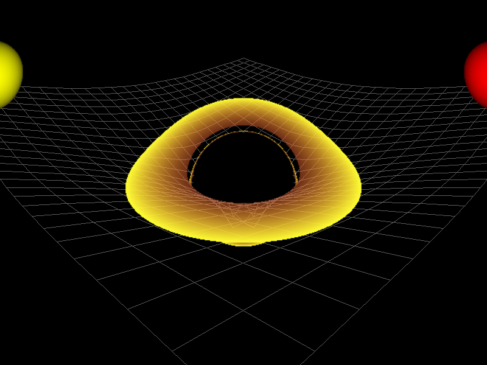
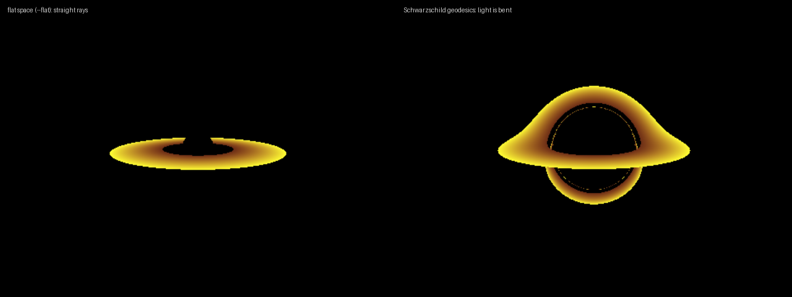
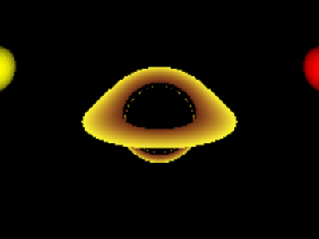
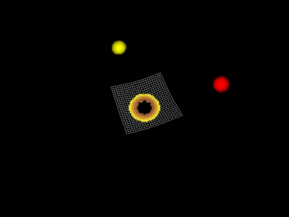
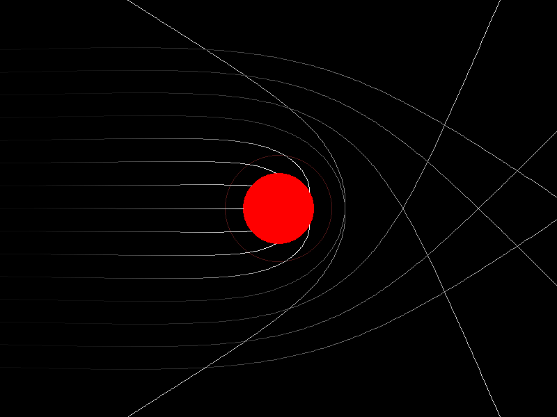

# Python Black Hole Simulator

A pure-Python (NumPy) port of [kavan010/black_hole](https://github.com/kavan010/black_hole): a ray-traced
Schwarzschild black hole with an accretion disk, gravitational lensing, orbiting bodies and a warped
spacetime grid. No GPU, OpenGL, CMake or compiler needed.



> Credit: the scene, camera controls, disk, grid and overall design come from Kavan's original C++/OpenGL
> project. This repository is an independent rewrite in Python, not a copy of his code. See
> [Differences from the original](#differences-from-the-original) for what changed and why.

## What's in it

| Command | Port of | What it does |
|---|---|---|
| `render` / `view` / `animate` | `black_hole.cpp`, `geodesic.comp`, `CPU-geodesic.cpp` | Ray-traced 3D black hole: lensed accretion disk, stars, spacetime grid, Newtonian gravity |
| `lensing2d` | `2D_lensing.cpp` | Light rays bending around the hole in 2D |
| `raytrace` | `ray_tracing.cpp` | A plain sphere ray tracer with diffuse light and shadows |



| Camera orbit | Stars orbiting the hole |
|---|---|
|  |  |



## Install

Python 3.10 or newer (developed and tested on 3.13).

```bash
git clone https://github.com/nave-neptunus/Python_BlackHoleSimulator.git
cd Python_BlackHoleSimulator
python3 -m venv .venv && source .venv/bin/activate
pip install -e ".[viewer]"
```

`.[viewer]` adds `pygame-ce` for the interactive windows. Stills and GIFs only need `numpy` and `pillow`
(`pip install -e .`).

## Usage

```bash
python -m blackhole_sim view                      # interactive 3D viewer
python -m blackhole_sim render -o hero.png --azimuth 225 --elevation 25 --distance 16
python -m blackhole_sim render --flat -o flat.png # same scene, no gravitational lensing
python -m blackhole_sim animate -o orbit.gif      # camera orbit
python -m blackhole_sim animate --mode gravity --orbit -o gravity.gif --distance 70 --elevation 60
python -m blackhole_sim lensing2d --interactive   # 2D light bending
python -m blackhole_sim raytrace -o spheres.png
```

Run `python -m blackhole_sim <command> --help` for all options. `--elevation` is degrees above the disk plane
(0 is edge-on, 90 is top-down) and `--distance` is in Schwarzschild radii.

### Viewer controls

| Input | Action |
|---|---|
| Left-drag | Orbit the camera |
| Mouse wheel | Zoom |
| Right mouse button (hold) or `G` | Newtonian gravity on the stars |
| `L` | Toggle gravitational lensing (curved vs. straight rays) |
| `T` | Toggle the spacetime grid |
| `R` / `S` / `Esc` | Reset / save `screenshot.png` / quit |

The scene is traced at low resolution while you drag or gravity runs, then re-traced at a higher
resolution once it is still, and upscaled to the window. It is a CPU renderer, so expect a fraction of a
second per refresh rather than 60 fps.

### As a library

```python
from PIL import Image
from blackhole_sim import Scene, Camera, render_image

scene = Scene.default()
image = render_image(scene, Camera(), size=(800, 600), render_size=(400, 300))
Image.fromarray(image).save("blackhole.png")
```

## How it works

Light follows null geodesics of the Schwarzschild metric. Because the metric is spherically symmetric,
every ray stays in a plane through the hole, so each ray is integrated in that plane with polar
coordinates `(r, φ)`. In units where the Schwarzschild radius `r_s = 1` the equations are

```
r''   = (r − 3/2) φ'²
φ''   = −2 r' φ' / r
```

All rays are advanced together with NumPy RK4 steps (`h = 0.04 r`); rays are dropped from the working set as
soon as they fall in (`r ≤ r_s`), hit the disk or a star, or escape outward past everything in the scene.
Hits are found by testing each step's segment against the disk plane and the spheres, so a large step cannot
skip over an object. The shading rules, disk colouring and alpha-blending over the grid follow the original
shader.

## Differences from the original

Most of these are fixes found while porting. I checked the first one numerically rather than just by reading.

- **Different light bending.** The 3D equations in `geodesic.comp` do not reduce to the Schwarzschild
  geodesic: the radial equation uses `r` where `r − r_s` is needed, and the energy is normalised
  inconsistently. Integrating the shader's equations on the equatorial plane with RK4, rays bend by only
  about 34% of general relativity's weak-field value `2 r_s / b` (b = 30 and 60 `r_s`). The equations here
  match that value to about 0.1% and give a shadow of radius `3√3/2 r_s` as expected (both are unit tests).
  The shader's function named `rk4Step` also performs a single Euler step.
- **No polar singularity.** The original tracks `θ` and divides by `sin θ`; integrating in each ray's own
  plane avoids that.
- **Proper observer.** Ray directions are converted to what a static observer at that radius would see.
- **Adaptive step and early exit** instead of 60,000 fixed steps, which is what makes a CPU renderer usable.
- **Camera defaults.** The original starts 5 `r_s` out, inside the disk's footprint. This starts at about
  12.6 `r_s`, 10° above the disk. Rays that begin exactly on the disk plane are not counted as crossing it.
- **Gravity.** Leapfrog integration with a real timestep that adapts to the local dynamical time, and bodies
  that cross the horizon are removed. The original adds acceleration to velocity and velocity to position
  once per frame with no timestep.
- **Grid.** Flamm's paraboloid with one constant vertical offset (the original subtracts a constant per body).
- **New:** `--flat` / `L` to compare lensed and straight rays, GIF export, click-to-fire rays in the 2D demo.

Not ported: `Gravity_Sim.zip`, the Windows `.exe`, and the CMake/vcpkg/VS Code build files.

## Limits

This is a visualisation, not a scientific tool. The black hole is non-rotating (Schwarzschild), the disk is
a thin flat annulus coloured by radius with no emission model, redshift or beaming, and there is no
background sky. The stars move under Newtonian gravity, not general relativity.

## Tests

```bash
pip install -e ".[dev]"
pytest
```

The tests check the integrator against known results: conserved energy and angular momentum, the weak-field
deflection `2 r_s / b + (15π/16)(r_s / b)²`, the photon-sphere capture threshold `b = 3√3/2 r_s`, and the
rendered shadow size.

## Project layout

```
blackhole_sim/
  geodesic.py   Schwarzschild null geodesics (vectorised RK4)
  scene.py      Scene, Body, Camera, Newtonian gravity, spacetime grid
  render.py     3D ray tracer and compositing over the grid
  lensing2d.py  2D light bending
  raytracer.py  Sphere ray tracer
  viewer.py     pygame viewers
  cli.py        Command line interface
tests/
docs/           Images used in this README
```

## License

The original project has no license file, so this repository does not currently declare one. All rights in
the original design remain with its author, [kavan010](https://github.com/kavan010/black_hole).
